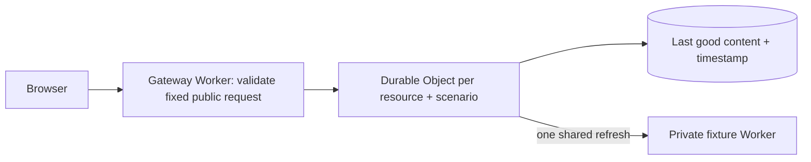

# Backstop

A small origin-protection experiment on Cloudflare Workers. It keeps public JSON
available when its origin slows down or briefly fails, and makes the behaviour
visible in a hands-on demo.

[Live demo](https://backstop.backstop.workers.dev) · [Source](https://github.com/Mohamedajab/backstop) · [Measured results](docs/benchmarks/README.md) · [Interview walkthrough](docs/walkthrough.md)


## The problem

If fifty requests arrive just after a popular resource expires, a basic cache can
send fifty requests to an already struggling origin. Backstop lets one request do
the refresh. Other requests either wait for it or get a recent cached copy.

The example content is a community noticeboard and library timetable: public
information where a slightly old copy can be more useful than an error page.
The fixture content is synthetic; this does not operate a real community service.

## Run locally

Requires Node.js 24 and npm. No Cloudflare login is needed for local development,
tests or benchmarks.

```sh
npm ci
npm run dev
```

Open `http://localhost:8787`. The dev command starts the gateway and fixture
Workers together. Try a request, repeat it within five seconds, then wait six
seconds and request again. The response changes from `MISS` to `HIT` to `STALE`.

The intermittent preset is available for the first ten seconds of each 30-second
server-clock cycle, then unavailable for twenty. A cold request during downtime
returns `503`; warm it during an available period to see stale fallback. Other
visitors share the same six resource/scenario combinations.

## How it works



| Content age | Behaviour |
| --- | --- |
| Under 5 seconds | Return a fresh cached copy (`HIT`). |
| 5 to under 65 seconds | Return the cached copy (`STALE`) and start or join one background refresh, unless in cooldown. |
| 65 seconds or older, or missing | Wait for one shared origin refresh (`MISS` / `COALESCED`). Return `503` if it fails. |

A refresh times out after two seconds, including body reading. A failure starts a
two-second cooldown. The last successful content and cooldown timestamp persist
in SQLite-backed Durable Object storage. The in-flight promise is deliberately
in memory: after a restart, a new request may start another origin fetch. The
design guarantees coordination within the current object lifetime, not exactly
one origin execution across crashes.

Each public resource has a separate object. There is no global coordinator, KV,
D1, queue or polling service. Every request goes through its object so the demo
can show coordination; it does not use a geographically distributed edge cache.

### Public interface

```sh
curl -i 'http://localhost:8787/api/content/notice?scenario=healthy'
curl -i 'http://localhost:8787/api/content/timetable?scenario=slow'
curl -i 'http://localhost:8787/api/content/notice?scenario=flaky'
curl 'http://localhost:8787/healthz'
```

- Only `GET`; the two resource IDs and three scenario values are fixed.
- `scenario` defaults to `healthy`. Duplicate or unknown parameters are rejected.
- Content endpoints reject Cookie, Authorization and Proxy-Authorization headers.
- `X-Backstop-Cache`: `MISS`, `COALESCED`, `HIT`, `STALE` or `UNAVAILABLE`.
- `X-Backstop-Age`: whole seconds since the last successful response was stored.
- `X-Backstop-Origin`: `cooldown` or `available-or-unchecked`; it is not a health probe.
- All API responses use `Cache-Control: no-store`. Browser caching cannot hide the experiment.
- Only HTTP 200, explicitly public JSON is cached. Responses with private/no-cache/no-store
  directives, cookies, Vary or content encoding are refused. Only Content-Type is retained.
- Body reading stops above 256 KiB, including chunked responses without Content-Length.
- The gateway constructs the origin URL itself, over a service binding. It never
  forwards client headers or fetches a user-supplied URL. The fixture has no public route.

The browser sends at most ten requests per button press. That is a UI limit, not
a server-side rate limit. Public traffic can still consume the account's quotas.

## Checks and measurements

```sh
npm run check             # generated types, TypeScript, 29 runtime cases, both deployment dry runs
npx playwright install chromium
npm run test:browser      # keyboard, real API responses, axe scan, responsive layouts
npm run bench            # three repeats; raw per-request results and assertions
```

The [runtime tests](test/backstop.test.ts) cover concurrent cold and stale
requests, failure cooldowns, expiry, recovery, persistence, isolation, timeout,
stream limits and unsafe responses. Origin behaviour is injected only in tests;
there are no test controls in the public API. GitHub Actions runs the checks and
browser test on pushes and pull requests. Benchmarks are run explicitly to avoid
mixing noisy CI timings with the recorded local measurements.

Across three local repeats, 150 cold requests produced **3 origin fetches** instead
of 150. During the controlled outage, **150/150 protected requests** returned stale
content; the direct-origin baseline returned no successful responses. See the
[method, timings and raw data](docs/benchmarks/README.md). These are controlled
single-machine results, not production throughput or a global availability claim.

## Deploy your own copy

SQLite-backed Durable Objects support Cloudflare's Workers Free plan. Do not
upgrade the account for this demo. Free quotas still apply; excessive traffic can
make operations fail. Check [current Durable Object pricing](https://developers.cloudflare.com/durable-objects/platform/pricing/).

```sh
npx wrangler login
npm run deploy
```

Deploy the private fixture first, then the gateway. If these Worker names already
exist in your account, change both names and the gateway's ORIGIN service binding
before deploying. Wrangler will print your `workers.dev` address. This project
uses no custom domains and does not modify DNS. Keep credentials outside the
repository. Production credentials are not needed by the checking workflow.

## What this doesn't prove

- A hot resource is coordinated by one object, which has finite throughput and
  adds a network hop. Native CDN caching may be a better choice for a real site.
- The project is intentionally limited to small public JSON. It is not a general
  HTTP caching implementation, arbitrary reverse proxy, security product or DDoS defence.
- A stale response describes the state before the current refresh finishes. Its
  age is the stored-copy age, not the age of data inside the origin's database.
- The timeout bounds client waiting. A service-bound origin that ignores abort
  can continue doing work after the gateway stops waiting; its late result is not cached.
- Freshness defaults are suitable for this demonstration. They are inappropriate
  for payments, authentication, emergency notices or other correctness-critical data.
- The demo has six fixed keys and no cache eviction policy. A larger content
  catalogue would need storage lifecycle and capacity planning.
- Automated accessibility checks are useful but do not replace testing with people
  using assistive technology. No global load test or production traffic study was run.

## Why this project

This adds practical TypeScript and Cloudflare runtime work to my backend portfolio:
request coordination, failure handling, trust boundaries and evidence that another
developer can reproduce. It is inspired by Cloudflare's
[cache stampede discussion](https://blog.cloudflare.com/sometimes-i-cache/) and
[Durable Object coordination guidance](https://developers.cloudflare.com/durable-objects/best-practices/rules-of-durable-objects/).
It is an independent portfolio experiment, not a Cloudflare product or affiliation.

AI assisted implementation, tests and documentation. The repository includes the
checks and measurements used to validate the result; AI output is not itself evidence.

MIT licensed. Built by [Mohamed Ajab](https://github.com/Mohamedajab).
