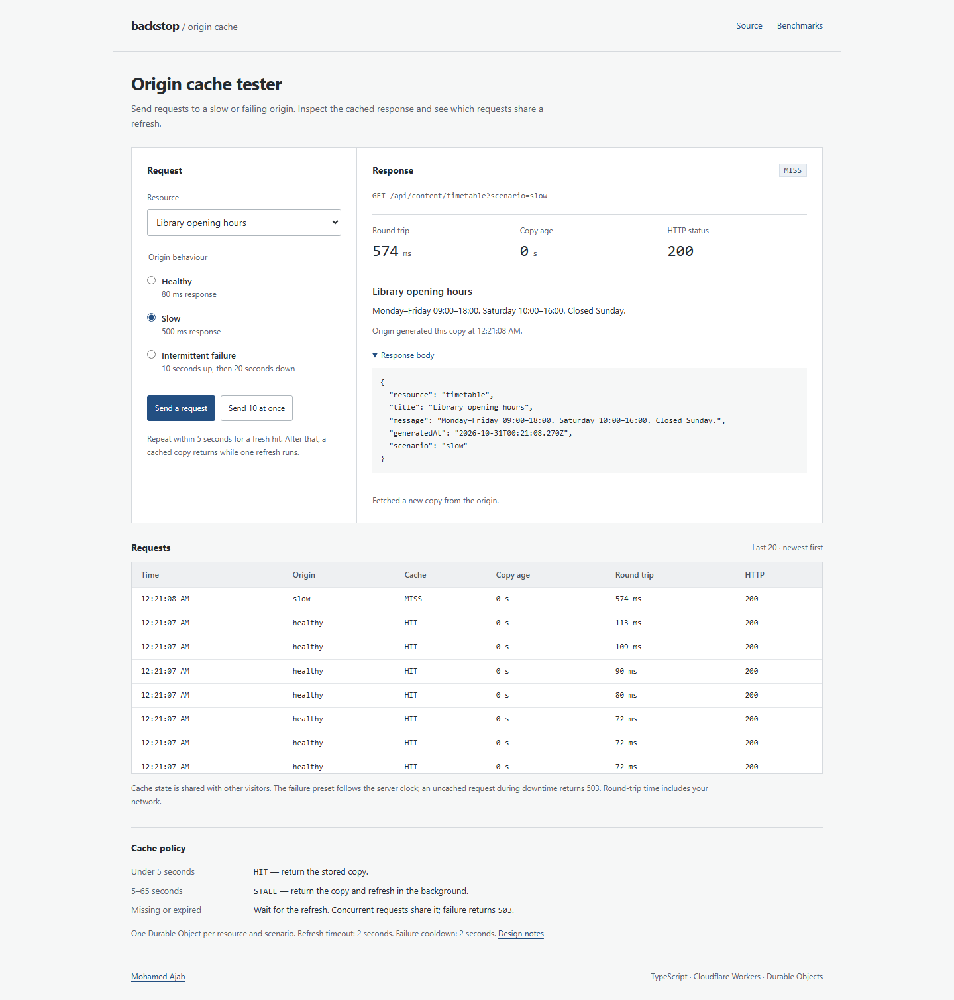

# Backstop

A public JSON cache on Cloudflare Workers. Concurrent requests share one origin
fetch; recent cached content stays available while the origin is slow or down.

[Demo](https://backstop.backstop.workers.dev) · [Verification and CV notes](docs/verification.md) · [Design notes](docs/design.md) · [Benchmarks](docs/benchmarks/README.md)



## Run

Node.js 24 and npm are required. Local development runs both Workers without a
Cloudflare account.

```sh
npm ci
npm run dev
```

Open `http://localhost:8787`. Send a request, repeat within five seconds for a
`HIT`, then wait six seconds to see `STALE` while a background refresh runs.

The fixture serves two sample resources: a noticeboard and a library timetable.
Choose an 80 ms origin, a 500 ms origin, or an origin that fails for twenty seconds
of each thirty-second server-clock cycle. State is shared between visitors. A cold
request during an outage returns `503` until the origin recovers.

## Cache behaviour

Each resource/scenario pair maps to a Durable Object. It stores the last good
response in SQLite and shares an in-flight refresh promise between requests.

| Copy age | Response |
| --- | --- |
| Under 5 seconds | `HIT`: return the stored copy. |
| 5 to under 65 seconds | `STALE`: return the copy and refresh in the background. |
| Missing or 65 seconds and older | Wait for a refresh: `MISS` or `COALESCED`. Return `503` on failure. |

Refreshes time out after two seconds. Failures trigger a two-second cooldown.
Stored content and cooldowns survive object restarts; in-flight work does not.
See [design notes](docs/design.md) for the failure paths and tradeoffs.

## API

```sh
curl -i 'http://localhost:8787/api/content/notice?scenario=healthy'
curl -i 'http://localhost:8787/api/content/timetable?scenario=slow'
curl -i 'http://localhost:8787/api/content/notice?scenario=flaky'
curl 'http://localhost:8787/healthz'
```

Only `GET` is supported. `scenario` defaults to `healthy`. Unknown resources,
unknown or duplicate parameters, cookies and authorization headers are rejected.

Responses include `X-Backstop-Cache`, `X-Backstop-Age` in seconds, and
`X-Backstop-Origin` (`cooldown` or `available-or-unchecked`). API responses use
`Cache-Control: no-store`, so browser caching does not affect the result.

Valid content requests use a platform limit of 60 requests per 60 seconds per
client IP. Rejected requests return JSON with HTTP `429` and `Retry-After: 60`,
before accessing the cache object. Health and static assets are excluded.
Local requests without Cloudflare's client-IP header share one development key.

The gateway fetches through a private service binding. It accepts only explicitly
public HTTP 200 JSON responses up to 256 KiB. Cookies, Vary, content encoding and
private/no-store/no-cache responses are refused; only Content-Type is retained.
Client headers and arbitrary URLs are never forwarded to the origin.

## Tests

```sh
npm run check
npx playwright install chromium
npm run test:browser
npm run bench
npm run smoke
```

`check` runs type checking, 33 Workers-runtime cases and deployment dry runs for
both Workers. The browser test checks keyboard interaction, responses, accessibility
and layout at 375, 768 and 1440 px. GitHub Actions runs both and the benchmark
assertions on pushes and pull requests, with each runner's results saved as an artifact.

The benchmark routes requests through two gateway Workers sharing one Durable
Object namespace. Three cold bursts used **3 origin fetches for 150 requests**,
versus 150 on the direct path. A separate 30-second test schedules 20 requests/sec
per path across two resources, including a 15-second outage. Backstop returned
**600/600 successful responses using 18 origin fetches**; the direct path made
600 origin calls and failed 300 requests. These are local single-machine measurements.
[Method and per-request data](docs/benchmarks/README.md).

`smoke` checks the hosted demo with a bounded set of requests. To test your own
deployment: `npm run smoke -- https://your-worker.workers.dev`.

## Deploy

```sh
npx wrangler login
npm run deploy
```

The deploy script uploads the private fixture before the gateway. Change both
Worker names and the ORIGIN service binding if those names already exist in your
account. The SQLite-backed objects work on Workers Free; account quotas apply.
No custom domain or DNS changes are needed.

## Limits

- One object coordinates each resource. Hot keys have finite throughput and add a
  network hop. Native CDN caching may be a better fit for a real site.
- The six sample keys have no eviction policy. A larger catalogue needs storage cleanup.
- Stale copies are unsuitable for data that must always be current. Copy age is
  measured from the last successful fetch, not from the underlying data's creation.
- A timeout stops waiting; an origin that ignores abort may keep doing work. Late
  results are discarded. A crash during a refresh can cause another origin fetch.
- The platform rate limit is approximate and local to each Cloudflare location.
  Visitors behind one IP share an allowance, while distributed traffic can still
  exhaust account quotas. It is not an account-wide spending cap. No production
  load or multi-region testing was run.

References: Cloudflare on [cache stampedes](https://blog.cloudflare.com/sometimes-i-cache/)
and [Durable Object coordination](https://developers.cloudflare.com/durable-objects/best-practices/rules-of-durable-objects/).

MIT licence.
